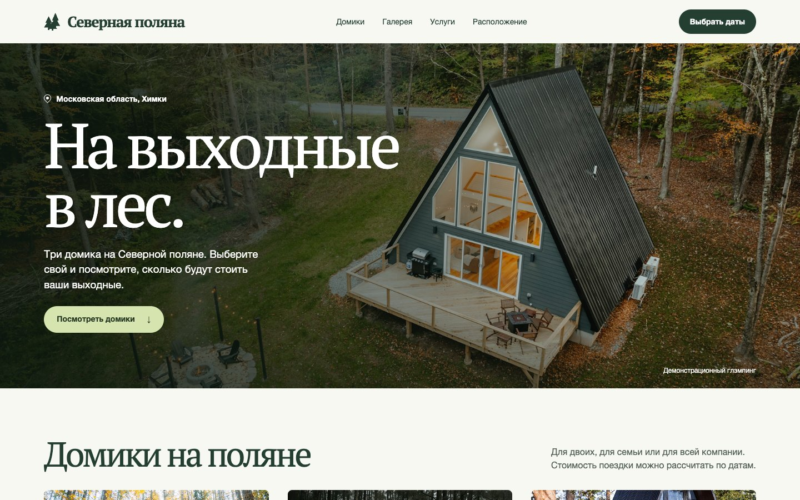
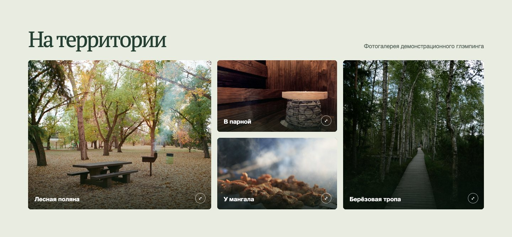

# Северная поляна

Учебный сайт глэмпинга в северном Подмосковье. Гость выбирает один из трёх домиков, отмечает в календаре даты заезда и выезда, добавляет услуги и видит полную стоимость до подтверждения. Бронирование демонстрационное, без оплаты и отправки заявки. Ориентир на карте — квартал Вашутино в Химках. Снимки иллюстрируют вымышленную территорию.

**[Открыть сайт на PipeCore](https://demo-site-f9f703.pipecore.io)**

## Как повторить практикум

Скопируйте сообщение целиком и отправьте своему AI-агенту в Codex.

> Давай создадим и опубликуем мой сайт по примеру https://github.com/qwwiwi/demo-practicum-site. Посмотри README, код и работающий пример https://demo-site-f9f703.pipecore.io. Помоги выбрать тему, предложи короткий план и обсуди его со мной до разработки. Используй Superpowers для плана и проверки, Marketing Skills для текста и Frontend Design для оформления. Собери сайт с реальными фотографиями, галереей и одним действием, которое посетитель может пройти до результата. Для глэмпинга это выбор домика, дат и услуг с расчётом цены и учебным подтверждением. Проверь сайт на телефоне и компьютере. Сохрани код, скриншоты и инструкцию в моём собственном репозитории GitHub, опубликуй сайт через PipeCore и пришли обе ссылки. Если нужен доступ к сервису, покажи мне, где его подключить.

**Что потребуется от вас.** Войдите в свой GitHub и подключите PipeCore к агенту. Когда создадите свою копию проекта, разрешите GitHub-приложению PipeCore доступ к выбранному репозиторию. Оригинал клуба останется доступен ученикам как образец. [GitHub](https://github.com/) · [Настройки подключения PipeCore](https://app.pipecore.io/settings/agent)

## Как мы сделали этот сайт

1. **Выбрали тему и сценарий.** Взяли север Подмосковья и придумали учебный глэмпинг. С помощью Superpowers согласовали, что гость сможет рассчитать цену и получить демо-подтверждение. [Superpowers](https://github.com/obra/superpowers)
2. **Подготовили содержание.** С помощью Marketing Skills описали три домика, вместимость, тарифы, услуги и действие на первом экране. [Marketing Skills](https://github.com/coreyhaines31/marketingskills)
3. **Собрали интерфейс.** С Frontend Design оформили первый экран, карточки, календарь и фотогалерею. Фотографии взяли с Unsplash, ссылки на оригиналы сохранили в проекте. [Frontend Design](https://github.com/anthropics/skills/tree/main/skills/frontend-design) · [Авторы снимков](images/CREDITS.md)
4. **Проверили расчёт и удобство.** Выбрали даты вручную и кнопкой «На выходные», проверили будничную и смешанную стоимость, добавление услуг, подтверждение и листание фотографий. Повторили сценарий на ширине телефона и компьютера.
5. **Сохранили и опубликовали.** Через GitHub CLI сохранили изменения в ветке, открыли запрос на включение изменений (pull request) и объединили их с основной версией. Затем обновили существующее приложение в PipeCore и проверили публичную страницу. Для своего проекта можно импортировать собственный репозиторий в новое приложение PipeCore. [История проекта](https://github.com/qwwiwi/demo-practicum-site/pulls?q=is%3Apr+is%3Amerged)



## Домики и стоимость

| Домик | Вместимость | Ночь с вс по чт | Ночь с пт по сб | Заезд в пятницу, выезд в воскресенье |
| --- | --- | ---: | ---: | ---: |
| Сосна | 2 гостя | 6 000 ₽ | 8 000 ₽ | 16 000 ₽ |
| Берёза | до 4 гостей | 8 500 ₽ | 10 500 ₽ | 21 000 ₽ |
| Кедр | до 6 гостей | 11 000 ₽ | 14 000 ₽ | 28 000 ₽ |

Кнопка «На выходные» выбирает ближайший заезд в пятницу и выезд в воскресенье. Для других сроков нажмите в календаре сначала день заезда, затем день выезда. Стоимость считается по каждой ночи, день выезда не оплачивается.

К поездке можно добавить баню (4 000 ₽ за два часа), мангальный набор (1 500 ₽ за комплект) и велосипеды (1 200 ₽ за пару на день). Каждая выбранная услуга добавляется один раз. Например, выходные в «Сосне» со всеми тремя услугами стоят 22 700 ₽.

## Территория и мобильная версия

В галерее можно рассмотреть поляну для пикника, мангал, парную и лесную тропу. [Источники фотографий](images/CREDITS.md).



[Посмотреть экран бронирования на телефоне](docs/screenshots/mobile-booking.png)

## Как запустить

Из каталога проекта выполните команду:

```sh
python3 -m http.server 8000
```

Откройте [локальную страницу](http://localhost:8000). Сайт работает на HTML, CSS и JavaScript. Разметка находится в `index.html`, оформление — в `style.css`, календарь и расчёт стоимости — в `booking.js` и `booking.css`.

Код учебного проекта хранится в этом публичном репозитории. Опубликованный сайт работает в приложении PipeCore `demo-site`, у которого отдельный внутренний Git-репозиторий. Для обновления сайта изменения из GitHub переносятся туда, затем запускается публикация.

## Урок 3 · Анализ социальных сетей с Loore

[Открыть дашборд Оскара Хартманна](https://demo-site-f9f703.pipecore.io/lesson-3-loore/dashboard.html) · [Материалы урока и обновление данных](lesson-3-loore/)
